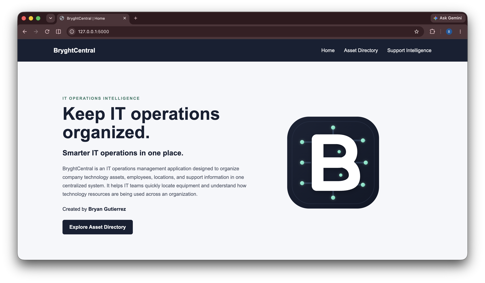
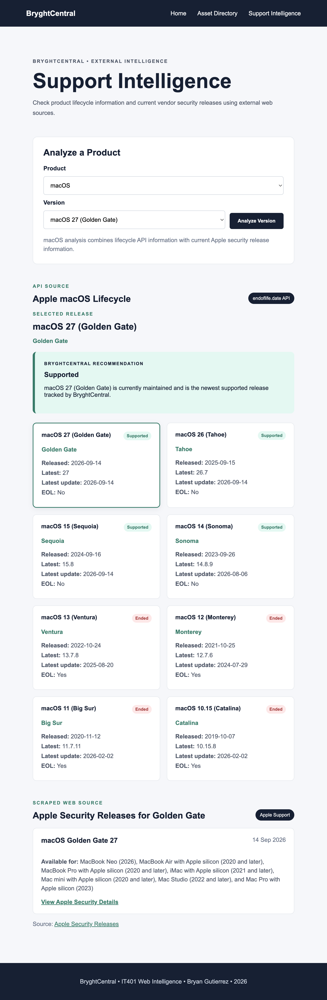
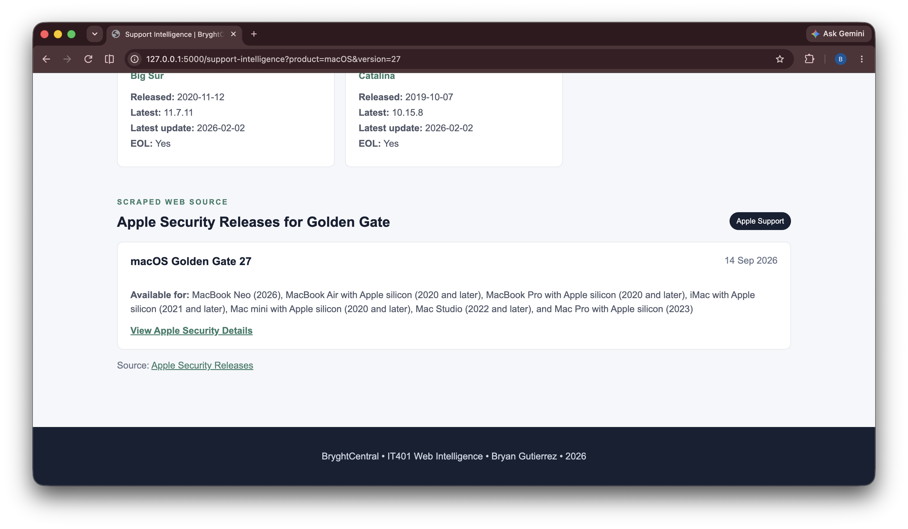
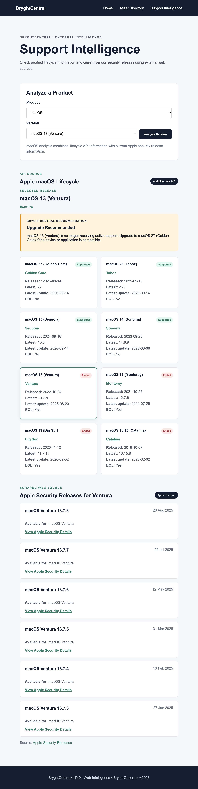
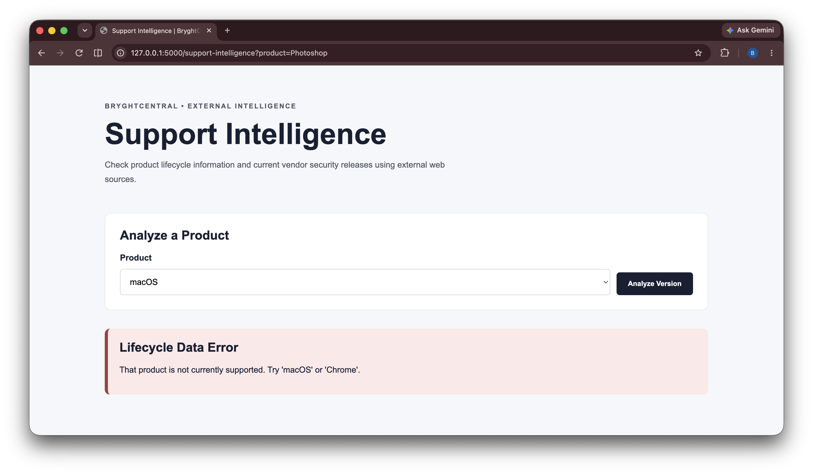

# BryghtCentral

**Student:** Bryan Gutierrez  
**Course:** IT 401 - Web Intelligence  
**Assignment:** A2 - Expanding the Web Intelligence Application Using an API

---

## Project Overview

BryghtCentral is an IT operations intelligence application designed to help IT teams organize, retrieve, and analyze information about technology assets and the software they depend on.

The original A1 version focused on locally stored IT asset information such as devices, assigned employees, departments, locations, and asset status.

For A2, BryghtCentral has been expanded to acquire current information from external web sources. The application now retrieves product lifecycle information from an external API and scrapes vendor security-release information from a publicly accessible webpage.

The purpose of the new Support Intelligence feature is to help IT staff determine whether a specific software version is still supported and whether an upgrade should be considered.

---

## Current Features

### Asset Directory

BryghtCentral continues to provide the A1 Asset Directory, including:

- Local JSON-based asset information
- Asset ID
- Device type
- Device model
- Assigned employee
- Department
- Location
- Asset status
- Search and filtering

### Support Intelligence

A2 adds a new Support Intelligence page with:

- Product selection
- Version selection
- External lifecycle API integration
- Current support-status information
- End-of-life detection
- Version-specific BryghtCentral recommendations
- Apple security-release web scraping
- Matching Apple security releases to selected macOS versions
- Supported and ended status indicators
- Graceful error handling

Current products supported by the A2 interface are:

- Apple macOS
- Google Chrome

---

## External Information Sources

BryghtCentral currently acquires information from two external web sources.

### 1. endoflife.date API

**Purpose:** Retrieve structured product lifecycle and support information.

BryghtCentral sends HTTP requests to the endoflife.date API and processes the JSON responses returned by the service.

Current API endpoints:

### macOS

```text
https://endoflife.date/api/v1/products/macos/
```

### Google Chrome

```text
https://endoflife.date/api/v1/products/chrome/
```

BryghtCentral extracts only information relevant to the application, including:

- Product version
- Release label
- Codename
- Release date
- Maintained status
- End-of-life status
- End-of-life date
- Latest version, when provided
- Latest update date, when provided

The application does not display the complete raw JSON response.

---

### 2. Apple Security Releases

**Source URL:**

```text
https://support.apple.com/en-us/100100
```

**Purpose:** Provide current vendor security-release information for macOS.

BryghtCentral retrieves Apple's public Security Releases webpage using Python `requests` and parses the returned HTML using BeautifulSoup.

The scraper extracts structured information including:

- Update name
- Supported or available-for information
- Release date
- Apple security-information link, when available

The scraper removes unnecessary HTML and keeps only macOS-related security-release information.

When a macOS release is selected, BryghtCentral uses the release codename to filter the scraped Apple information.

For example:

```text
macOS 13
    ↓
Ventura
    ↓
Apple Ventura security releases
```

---

## Application Workflow

BryghtCentral combines external API data and scraped webpage data into one Support Intelligence interface.

```text
User
 │
 │ selects product + version
 ▼
BryghtCentral
 │
 ├────────────────────────┐
 │                        │
 ▼                        ▼
endoflife.date         Apple Support
API                    webpage
 │                        │
 │ JSON                   │ HTML
 ▼                        ▼
Lifecycle              BeautifulSoup
processing             scraper
 │                        │
 └──────────┬─────────────┘
            │
            ▼
     Data cleaning and
       normalization
            │
            ▼
    Support Intelligence
            │
            ▼
      BryghtCentral
      recommendation
```

### Example Workflow

A user selects:

```text
Product: macOS
Version: macOS 13 (Ventura)
```

The lifecycle API reports that macOS 13 is no longer maintained.

BryghtCentral then generates a recommendation such as:

```text
BRYGHTCENTRAL RECOMMENDATION

Upgrade Recommended

macOS 13 (Ventura) is no longer receiving active support.
Upgrade to a currently supported release if the device or
application is compatible.
```

The application also displays Apple security-release information related to Ventura.

---

## Information Model

BryghtCentral currently uses both local and externally acquired information.

### Local Information

#### Asset

Current local asset attributes include:

- Asset ID
- Device type
- Device model
- Assigned employee
- Department
- Location
- Status

Local asset information is currently stored in:

```text
data/assets.json
```

---

### External Lifecycle Information

Lifecycle information retrieved from the API may include:

- Product
- Version
- Label
- Codename
- Release date
- Maintained status
- End-of-life status
- End-of-life date
- Latest version
- Latest release date

This information is dynamically retrieved from the endoflife.date API.

---

### External Security Release Information

Apple security-release records include:

- Update name
- Available-for information
- Release date
- Security-information URL

This information is dynamically acquired by scraping Apple's public Security Releases webpage.

---

## Data Integration

The API and scraped information support the same application purpose: helping IT staff determine whether software remains appropriate for continued use.

For macOS, BryghtCentral combines:

```text
Lifecycle information
        +
Apple security-release information
        ↓
Support Intelligence
```

The lifecycle API identifies whether a macOS release is still maintained or has reached end of life.

The scraped Apple information provides current vendor security-release information related to the selected version.

The two sources therefore provide related operational context rather than being displayed as unrelated datasets.

---

## User Interaction

The Support Intelligence page allows the user to select:

1. A product
2. A specific version

Current products include:

```text
macOS
Google Chrome
```

The available version list changes based on the selected product.

The selected version affects:

- The lifecycle record analyzed
- Support status
- End-of-life status
- BryghtCentral's recommendation
- Apple security-release filtering for macOS

The user can change the query without modifying application source code.

---

## BryghtCentral Recommendations

BryghtCentral uses externally acquired lifecycle information to generate basic decision-support recommendations.

### Supported Release

Example:

```text
Supported

macOS 15 (Sequoia) is still maintained and receiving support.
```

A supported version may still have a newer supported release available.

---

### Ended Release

Example:

```text
Upgrade Recommended

macOS 13 (Ventura) is no longer receiving active support.
Upgrade to a currently supported release if the device
or application is compatible.
```

Similar logic is used when evaluating Google Chrome releases.

These recommendations provide an early foundation for more advanced intelligence features later in the semester.

---

## Data Cleaning and Normalization

External information sources do not always use identical structures.

BryghtCentral normalizes external information before sending it to the interface.

Examples include:

- Extracting only relevant API fields
- Converting lifecycle records into a consistent Python structure
- Handling missing values
- Distinguishing between products that provide patch-level information and products that do not
- Removing unnecessary webpage HTML
- Filtering scraped Apple records to macOS
- Matching Apple records using macOS codenames
- Handling records without security-information links

This allows information from different sources to be presented through a consistent application interface.

---

## Reliability and Error Handling

BryghtCentral is designed to display useful messages instead of crashing when an external source fails or user input is invalid.

### Unsupported Product

Example:

```text
Lifecycle Data Error

That product is not currently supported.
Try 'macOS' or 'Chrome'.
```

---

### Invalid Version

Example:

```text
Invalid Selection

Version '999' was not found for macOS.
```

---

### API Failures

The lifecycle API service handles:

- HTTP errors
- Connection failures
- Network errors
- Request timeouts
- Invalid JSON responses
- Empty API results

A useful error message is returned instead of allowing the application to crash.

---

### Web Scraping Failures

The Apple scraper handles:

- HTTP request failures
- Connection failures
- Request timeouts
- Missing HTML tables
- Missing individual fields
- Security releases without information links

If the structure of Apple's webpage changes and the expected table cannot be located, the application returns an error message rather than crashing.

---

## Environment Variables

The current A2 implementation does not require an API key.

The endoflife.date API used by BryghtCentral is accessible for the current project without authentication.

Therefore, no environment variables are required to run the current A2 implementation.

The `.gitignore` file still includes:

```text
.env
```

so credentials can be stored safely if an authenticated external service is added in a later assignment.

---

## Ethical Considerations

BryghtCentral retrieves information only from publicly accessible sources.

### Source Attribution

External data sources are identified in both the application and project documentation.

Current external sources are:

- endoflife.date
- Apple Support

### Responsible Web Scraping

The Apple scraper retrieves only information required for the Support Intelligence feature.

It does not:

- Bypass authentication
- Access private information
- Modify information on the source website
- Submit forms
- Attempt to bypass access controls
- Download unnecessary content

The scraper converts publicly available security-release information into structured data for educational use.

### Responsible API Usage

BryghtCentral performs standard HTTP requests and does not intentionally send unnecessary repeated requests.

Future development should continue respecting:

- API rate limits
- Website terms of use
- Source attribution requirements
- External service limitations

---

## Known Limitations

The current A2 implementation is intentionally limited in scope.

Current limitations include:

- Only macOS and Google Chrome are supported.
- Apple security-release scraping applies only to macOS.
- External information is requested each time the page is loaded.
- External information is not yet stored persistently.
- Recommendations currently use basic lifecycle rules.
- Hardware compatibility is not yet evaluated.
- Asset records are not yet automatically matched with operating-system or browser versions.
- External webpage structure changes may require scraper updates.
- External information quality depends on the original sources.

---

## Project Structure

```text
bryan-it401-project/
│
├── app.py
│
├── README.md
│
├── requirements.txt
│
├── .gitignore
│
├── data/
│   └── assets.json
│
├── routes/
│   └── main.py
│
├── services/
│   ├── lifecycle_api.py
│   └── apple_scraper.py
│
├── static/
│   ├── style.css
│   ├── images/
│   │   └── bryghtcentral-logo.svg
│   └── screenshots/
│       ├── a2-homepage.png
│       ├── a2-api-results.png
│       ├── a2-scraped-results.png
│       ├── a2-combined-interface.png
│       └── a2-error-handling.png
│
└── templates/
    ├── base.html
    ├── index.html
    ├── assets.html
    └── support_intelligence.html
```

### File Responsibilities

`app.py`  
Starts the Flask application.

`routes/main.py`  
Contains BryghtCentral's Flask routes and application-level processing.

`services/lifecycle_api.py`  
Retrieves and normalizes lifecycle information from the external API.

`services/apple_scraper.py`  
Retrieves and parses Apple's public Security Releases webpage.

`data/assets.json`  
Contains locally stored asset information.

`templates/support_intelligence.html`  
Displays external information, product/version selection, errors, and BryghtCentral recommendations.

---

## Installation Instructions

### 1. Clone the Repository

```bash
git clone https://github.com/Bryan-Gutierrez-IT/bryan-it401-project.git
```

Move into the repository:

```bash
cd bryan-it401-project
```

---

### 2. Switch to the A2 Branch

```bash
git switch bryan-it401-a2
```

---

### 3. Create a Virtual Environment

```bash
python3 -m venv .venv
```

---

### 4. Activate the Virtual Environment

#### macOS

```bash
source .venv/bin/activate
```

#### Windows

```bash
.venv\Scripts\activate
```

---

### 5. Install Dependencies

```bash
pip install -r requirements.txt
```

A2 uses libraries including:

- Flask
- requests
- BeautifulSoup

---

### 6. Run BryghtCentral

```bash
python app.py
```

Open the homepage at:

```text
http://127.0.0.1:5000
```

Asset Directory:

```text
http://127.0.0.1:5000/assets
```

Support Intelligence:

```text
http://127.0.0.1:5000/support-intelligence
```

---

## Screenshots

### Homepage

The BryghtCentral homepage provides access to the existing Asset Directory and the new Support Intelligence feature.



---

### API Results

The Support Intelligence page retrieves lifecycle information from the endoflife.date API.



---

### Scraped Results

BryghtCentral scrapes Apple's public Security Releases webpage and converts relevant macOS information into structured records.



---

### Combined Interface

The combined Support Intelligence interface uses external lifecycle information and vendor security information to help evaluate a selected software version.

The example below shows macOS 13 Ventura being identified as no longer actively supported.



---

### Error Handling

BryghtCentral displays useful error messages when unsupported input is provided instead of crashing.



---

## Future Work

Assignment A3 will introduce persistent storage.

BryghtCentral can be extended so that local and externally acquired information is stored persistently rather than retrieved or loaded only when needed.

Potential A3 work includes storing:

- Assets
- Employees
- Product and version assignments
- Lifecycle information
- Support status
- External data retrieval dates
- Upgrade recommendations

Persistent storage will allow later versions of BryghtCentral to connect asset records with support intelligence and build more advanced search, analysis, and decision-support capabilities.

---

## Technologies Used

- Python
- Flask
- HTML
- CSS
- Jinja
- JSON
- Requests
- BeautifulSoup
- REST APIs
- Web scraping
- Git
- GitHub