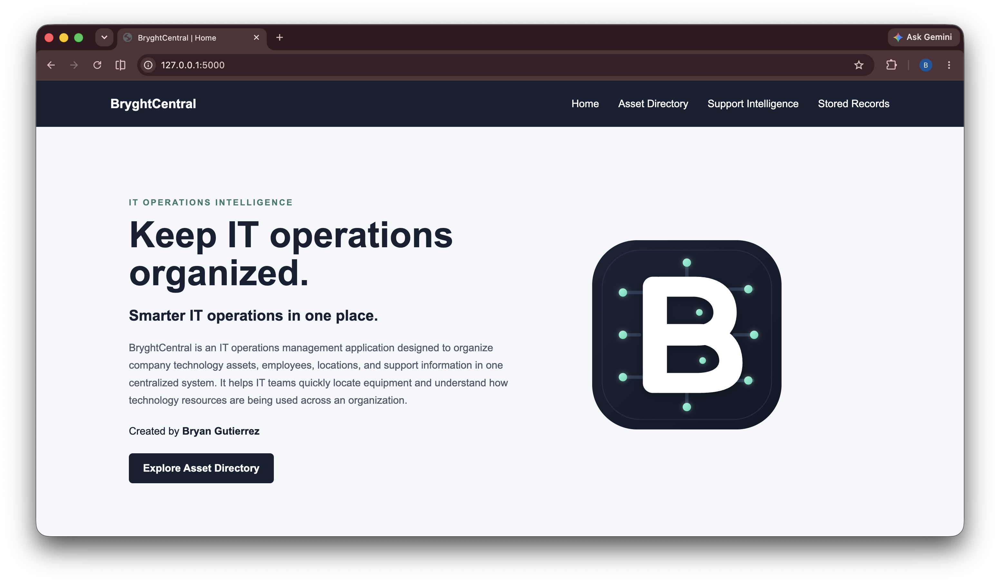
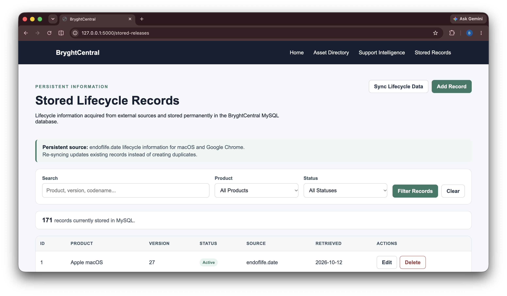
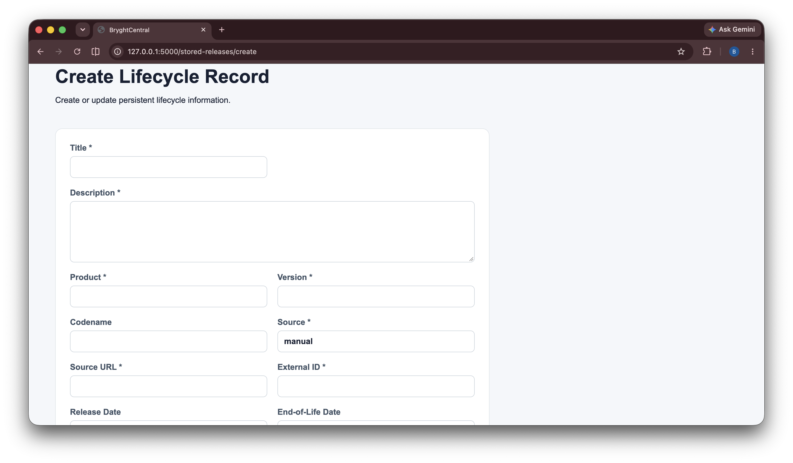
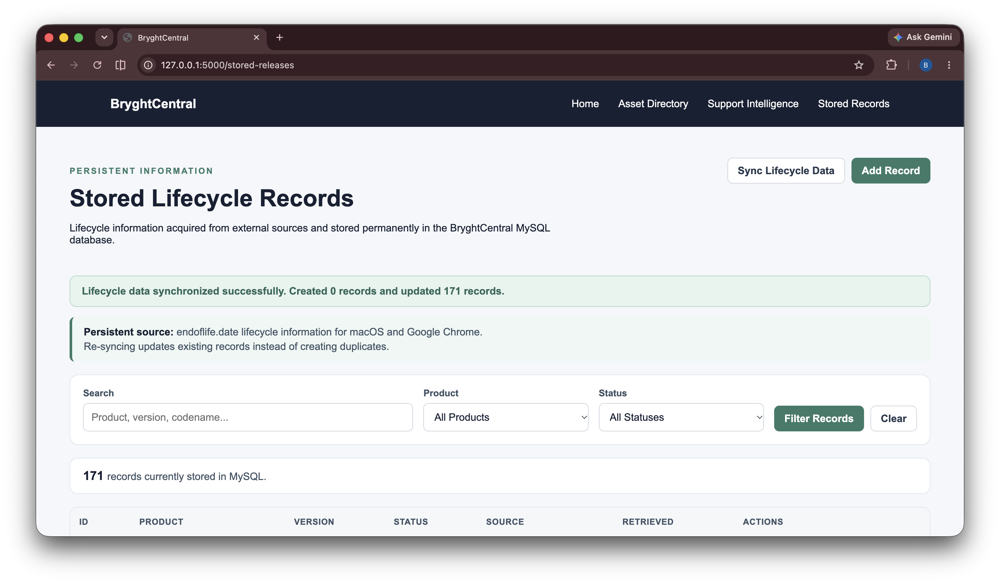
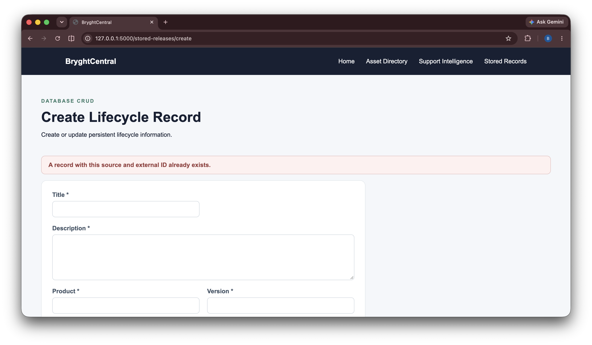

# BryghtCentral

**Student:** Bryan Gutierrez  
**Course:** IT 401 - Web Intelligence  
**Assignment:** A3 - Expanding the Web Intelligence Application with Information Persistence  

---

## Project Overview

BryghtCentral is an IT operations intelligence application designed to help IT teams organize, retrieve, and analyze information about technology assets and the software they depend on.

The original A1 version introduced a local Asset Directory containing device, employee, department, location, and status information.

A2 expanded BryghtCentral by acquiring current information from external sources. The application retrieves product lifecycle information from the endoflife.date API and scrapes Apple's public Security Releases webpage.

A3 adds **information persistence**. Lifecycle information acquired from endoflife.date can now be stored permanently in a MySQL database using Flask-SQLAlchemy.

Instead of losing all acquired information when a request ends, BryghtCentral can now:

- Store lifecycle records permanently
- Retrieve stored records from MySQL
- Search and filter database records
- Create records through the web interface
- Update existing records
- Delete records
- Synchronize current API information with the database
- Prevent duplicate external records
- Validate information before it is stored

The long-term purpose of BryghtCentral is to help IT staff make better operational decisions about technology assets, software support, lifecycle status, and upgrade requirements.

---

## Intended Users

BryghtCentral is designed primarily for:

- IT support staff
- Help desk technicians
- System administrators
- IT operations teams
- Asset management personnel

These users may need to determine whether software remains supported, identify outdated versions, track technology lifecycle information, and eventually connect that information with organizational assets.

---

# Information Persistence

## What Is Stored Permanently

A3 persists lifecycle information acquired from the **endoflife.date API**.

The persistent dataset currently includes lifecycle records for:

- Apple macOS
- Google Chrome

Each lifecycle release is transformed into a `LifecycleRecord` object and stored in the MySQL database.

During A3 testing, BryghtCentral stored:

```text
171 lifecycle records
```

These included macOS and Google Chrome release records.

Stored information includes:

- Product
- Version
- Codename
- Release date
- Maintained status
- End-of-life status
- End-of-life date
- Latest version
- Latest release date
- Source
- Source URL
- External identifier
- Retrieved date
- Created date
- Description

Persisting this information allows BryghtCentral to reuse previously acquired data instead of relying only on temporary API responses.

---

## Why Lifecycle Information Is Persisted

Lifecycle information is useful beyond the request that originally retrieved it.

Persisting it allows BryghtCentral to:

- Retain information after the application stops
- Reduce unnecessary external API requests
- Search previously acquired lifecycle information
- Compare lifecycle records
- Track information from external sources
- Support future retrieval and ranking features
- Build future intelligent recommendations
- Maintain a foundation for later decision-support features

The stored information also provides historical context that would not exist if every API result disappeared after the request ended.

---

## Information That Remains Temporary

Not all BryghtCentral information is persisted yet.

The following currently remains temporary or outside the MySQL persistence layer:

### Apple Security Releases

Apple security-release information is still retrieved dynamically by scraping Apple's public Security Releases webpage.

This information is displayed through the Support Intelligence interface but is not currently stored in MySQL.

### User Search State

Search text, filters, and the currently selected Support Intelligence product/version exist only for the current request.

### Asset Directory

The original Asset Directory continues to use:

```text
data/assets.json
```

Asset information has not yet been migrated into MySQL.

This allows A3 to remain focused on persisting one externally acquired dataset while preparing the project for later expansion.

---

# Database Integration

BryghtCentral uses the following persistence stack:

```text
Flask
   ↓
Flask-SQLAlchemy
   ↓
SQLAlchemy ORM
   ↓
PyMySQL
   ↓
MySQL / MariaDB-compatible database on CI Keys
```

Flask handles the web application.

Flask-SQLAlchemy integrates SQLAlchemy with Flask.

SQLAlchemy maps Python model objects to relational database records.

PyMySQL provides the database driver.

The database is hosted through CI Keys.

During local development, BryghtCentral connects to the CI Keys database through an SSH tunnel.

---

# Database Schema

## LifecycleRecord

The main A3 table is:

```text
lifecycle_records
```

### Purpose

Stores lifecycle information acquired from endoflife.date.

### Primary Key

```text
id
```

The `id` field is BryghtCentral's internal database identifier.

### Required Assignment Fields

The model includes the required A3 information-model fields:

| Field | Purpose |
|---|---|
| `id` | Internal primary key |
| `title` | Human-readable record title |
| `description` | Description of the lifecycle record |
| `source` | External information source |
| `source_url` | URL associated with the source |
| `retrieved_date` | Date/time information was retrieved |
| `created_date` | Date/time the database record was created |

### Additional BryghtCentral Fields

| Field | Purpose |
|---|---|
| `product` | Product represented by the record |
| `version` | Product release/version |
| `codename` | Release codename when available |
| `release_date` | Original release date |
| `is_maintained` | Whether the release is actively maintained |
| `is_eol` | Whether the release has reached end of life |
| `eol_date` | End-of-life date when available |
| `latest_version` | Most recent version information supplied by the source |
| `latest_release_date` | Latest release/update date when available |
| `external_id` | BryghtCentral identifier for an external release |

These additional attributes are required because BryghtCentral uses lifecycle status to determine whether software is supported or should be considered for an upgrade.

---

## Duplicate Constraint

BryghtCentral uses the combination:

```text
source + external_id
```

as a unique database constraint.

For example:

```text
source = endoflife.date
external_id = macos:27
```

cannot appear twice.

This prevents repeated synchronization from creating duplicate copies of the same external lifecycle record.

---

## Entity Relationship Diagram

A3 currently uses one primary persistent entity.

```text
┌──────────────────────────────┐
│       LifecycleRecord        │
├──────────────────────────────┤
│ PK  id                       │
│     title                    │
│     description              │
│     source                   │
│     source_url               │
│     retrieved_date           │
│     created_date             │
│     product                  │
│     version                  │
│     codename                 │
│     release_date             │
│     is_maintained            │
│     is_eol                   │
│     eol_date                 │
│     latest_version           │
│     latest_release_date      │
│     external_id              │
├──────────────────────────────┤
│ UNIQUE(source, external_id)  │
└──────────────────────────────┘
```

No table relationships are required in the current A3 implementation.

Future versions may introduce relationships between lifecycle information, assets, employees, software assignments, and locations.

---

# Application Architecture

BryghtCentral now separates application responsibilities across multiple files and directories.

```text
Browser / User
      │
      ▼
Flask Routes
      │
      ├───────────────► Templates
      │
      ▼
Services / Business Logic
      │
      ├───────────────► endoflife.date API
      │
      ├───────────────► Apple Support Webpage
      │
      ▼
Validation / Normalization
      │
      ▼
SQLAlchemy Models
      │
      ▼
Flask-SQLAlchemy
      │
      ▼
MySQL Database
```

The application no longer depends on a single file for all functionality.

Major responsibilities are separated into:

- Application initialization
- Database extensions
- Models
- Routes
- External acquisition services
- Persistence services
- Templates
- Static files

---

# Information Flow

## External Lifecycle Synchronization

The A3 synchronization process follows this workflow:

```text
User
  │
  │ clicks "Sync Lifecycle Data"
  ▼
Flask Route
  │
  ▼
Lifecycle Persistence Service
  │
  ▼
endoflife.date API
  │
  │ JSON
  ▼
Lifecycle API Processing
  │
  ▼
Validation and Normalization
  │
  ▼
Check Existing Record
  │
  ├──── record exists ───► UPDATE
  │
  └──── new record ──────► CREATE
  │
  ▼
SQLAlchemy Session
  │
  ▼
MySQL
  │
  ▼
Stored Records Page
```

---

## Duplicate-Safe Synchronization

When the synchronization button is used, BryghtCentral checks whether each external record already exists.

If it does not exist:

```text
CREATE record
```

If it already exists:

```text
UPDATE existing record
```

During testing, running synchronization against the existing dataset produced:

```text
Created 0 records
Updated 171 records
```

The total remained:

```text
171 records
```

This confirms that synchronization updates existing information instead of creating duplicates.

---

# CRUD Functionality

A3 provides complete CRUD functionality through the web interface.

## Create

Users can select:

```text
Add Record
```

and manually create a lifecycle record.

Required fields are validated before the record is accepted.

---

## Read

The Stored Records page retrieves persistent information directly from MySQL.

```text
/stored-releases
```

The interface displays:

- Record ID
- Product
- Version
- Lifecycle status
- Source
- Retrieved date
- Edit action
- Delete action

---

## Update

Each record includes an:

```text
Edit
```

action.

Users can modify stored lifecycle information and save the changes back to MySQL.

---

## Delete

Each record includes a:

```text
Delete
```

action.

The browser requests confirmation before the record is removed.

If the operation succeeds, the database transaction is committed.

If it fails, the transaction is rolled back.

---

# Search and Filtering

Stored lifecycle information can be searched and filtered without modifying application source code.

The Stored Records page supports:

### Text Search

Searchable fields include:

- Title
- Product
- Version
- Codename
- Source

### Product Filter

Records can be filtered by product.

Examples include:

```text
Apple macOS
Google Chrome
```

### Status Filter

Lifecycle records can be filtered by:

```text
Active
Ended
```

The interface also displays the number of matching records compared with the total number stored.

---

# Data Validation

BryghtCentral validates information before storing or updating database records.

Validation includes:

- Required field checking
- URL validation
- Date parsing
- Missing-value handling
- Duplicate detection
- Database uniqueness enforcement
- Invalid input rejection

---

## Required Fields

The following fields are required when creating or updating a record:

- Title
- Description
- Source
- Source URL
- Product
- Version
- External ID

If required information is missing, BryghtCentral displays an error instead of creating an incomplete record.

---

## URL Validation

Source URLs must begin with:

```text
http://
```

or:

```text
https://
```

Invalid source URLs are rejected.

---

## Date Validation

Date values are parsed before being stored.

Invalid date values are rejected instead of being written to the database.

Missing optional dates are stored as null values.

---

## Duplicate Handling

Before creating a record, BryghtCentral checks:

```text
source + external_id
```

If that combination already exists, the application displays:

```text
A record with this source and external ID already exists.
```

The database also enforces the same uniqueness rule.

This provides both application-level and database-level duplicate protection.

---

# External Information Sources

## 1. endoflife.date API

**Purpose:** Retrieve structured product lifecycle information.

Current endpoints:

### macOS

```text
https://endoflife.date/api/v1/products/macos/
```

### Google Chrome

```text
https://endoflife.date/api/v1/products/chrome/
```

BryghtCentral extracts information such as:

- Product version
- Codename
- Release date
- Maintained status
- End-of-life status
- End-of-life date
- Latest version
- Latest release date

This is the external dataset persisted in MySQL for A3.

---

## 2. Apple Security Releases

**Source:**

```text
https://support.apple.com/en-us/100100
```

BryghtCentral retrieves Apple's public Security Releases webpage using Python `requests` and parses the HTML with BeautifulSoup.

The scraper extracts:

- Update name
- Available-for information
- Release date
- Security-information URL

Apple security information remains temporary during A3 and is not currently stored in MySQL.

---

# Support Intelligence

The Support Intelligence interface continues the A2 functionality.

Users select:

1. Product
2. Version

BryghtCentral then evaluates lifecycle information and produces a basic recommendation.

Example:

```text
macOS 13
    ↓
Ventura
    ↓
End of Life
    ↓
Upgrade Recommended
```

For macOS, BryghtCentral also displays matching Apple security-release information.

---

# BryghtCentral Recommendations

BryghtCentral currently uses basic lifecycle rules.

## Supported

If a release remains actively maintained:

```text
Supported
```

Example:

```text
macOS 15 (Sequoia) is still maintained and receiving support.
```

---

## Upgrade Recommended

If a release has reached end of life or is no longer maintained:

```text
Upgrade Recommended
```

Example:

```text
macOS 13 (Ventura) is no longer receiving active support.

Upgrade to a currently supported release if the device
or application is compatible.
```

These rules provide the foundation for more advanced intelligent analysis later in the semester.

---

# Current Features

BryghtCentral currently includes:

### Homepage

Provides navigation to the primary application features.

### Asset Directory

Provides locally stored IT asset information from JSON.

### Support Intelligence

Provides:

- External lifecycle API integration
- Product selection
- Version selection
- Lifecycle analysis
- Support-status detection
- Upgrade recommendations
- Apple Security Releases web scraping
- External source attribution
- Error handling

### Stored Records

Provides:

- MySQL persistence
- SQLAlchemy database integration
- Browser-based lifecycle synchronization
- Create functionality
- Read functionality
- Update functionality
- Delete functionality
- Search
- Product filtering
- Status filtering
- Duplicate handling
- Input validation
- Persistent lifecycle information

---

# Project Structure

```text
bryan-it401-project/
│
├── app.py
├── extensions.py
├── README.md
├── requirements.txt
├── .gitignore
├── .env.example
├── sync_lifecycle.py
│
├── data/
│   └── assets.json
│
├── migrations/
│   ├── versions/
│   └── ...
│
├── models/
│   ├── __init__.py
│   └── lifecycle.py
│
├── routes/
│   ├── main.py
│   └── lifecycle_records.py
│
├── services/
│   ├── lifecycle_api.py
│   ├── lifecycle_persistence.py
│   └── apple_scraper.py
│
├── static/
│   ├── style.css
│   ├── images/
│   │   └── bryghtcentral-logo.svg
│   └── screenshots/
│       ├── a2-homepage.png
│       ├── a2-api-results.png
│       ├── a2-scraped-results.png
│       ├── a2-combined-interface.png
│       ├── a2-error-handling.png
│       ├── a3-homepage.png
│       ├── a3-stored-records.png
│       ├── a3-crud-interface.png
│       ├── a3-sync-success.png
│       └── a3-validation.png
│
└── templates/
    ├── base.html
    ├── index.html
    ├── assets.html
    ├── support_intelligence.html
    ├── stored_releases.html
    └── lifecycle_form.html
```

---

# File Responsibilities

## `app.py`

Creates and configures the Flask application.

Responsibilities include:

- Loading environment variables
- Configuring the SQLAlchemy database URI
- Initializing SQLAlchemy
- Initializing Flask-Migrate
- Registering application routes
- Registering lifecycle CRUD routes

---

## `extensions.py`

Defines reusable Flask extensions:

```text
SQLAlchemy
Flask-Migrate
```

---

## `models/lifecycle.py`

Defines the `LifecycleRecord` SQLAlchemy model and database schema.

---

## `routes/main.py`

Contains the original BryghtCentral application routes, including:

- Homepage
- Asset Directory
- Support Intelligence

---

## `routes/lifecycle_records.py`

Contains A3 persistence routes for:

- Stored records
- Search
- Filtering
- Synchronization
- Create
- Update
- Delete
- Validation

---

## `services/lifecycle_api.py`

Retrieves and normalizes lifecycle information from endoflife.date.

---

## `services/lifecycle_persistence.py`

Connects the external lifecycle acquisition process with persistent storage.

Responsibilities include:

- Retrieving lifecycle data
- Transforming information into database records
- Checking existing records
- Creating new records
- Updating existing records
- Preventing duplicate synchronization
- Committing or rolling back database transactions

---

## `services/apple_scraper.py`

Retrieves and parses Apple's public Security Releases webpage.

---

## `sync_lifecycle.py`

Provides a command-line method for synchronizing lifecycle information.

The application now also provides synchronization through the web interface.

---

## `templates/stored_releases.html`

Displays persistent MySQL lifecycle information.

It also provides:

- Synchronization button
- Search
- Filtering
- Edit actions
- Delete actions
- Database record counts

---

## `templates/lifecycle_form.html`

Provides the Create and Update interface for persistent lifecycle records.

---

# Installation Instructions

## 1. Clone the Repository

```bash
git clone https://github.com/Bryan-Gutierrez-IT/bryan-it401-project.git
```

Move into the repository:

```bash
cd bryan-it401-project
```

---

## 2. Switch to the A3 Branch

```bash
git switch bryan-it401-a3
```

---

## 3. Create a Virtual Environment

```bash
python3 -m venv .venv
```

---

## 4. Activate the Virtual Environment

### macOS / Linux

```bash
source .venv/bin/activate
```

### Windows

```bash
.venv\Scripts\activate
```

---

## 5. Install Dependencies

```bash
pip install -r requirements.txt
```

Major A3 dependencies include:

- Flask
- Flask-SQLAlchemy
- Flask-Migrate
- SQLAlchemy
- PyMySQL
- python-dotenv
- requests
- BeautifulSoup

---

# Environment Variables

Database credentials and application secrets are not stored directly in source code.

Create:

```text
.env
```

in the project root.

Example:

```text
DB_USERNAME=your_database_username
DB_PASSWORD=your_database_password
DB_HOST=127.0.0.1
DB_PORT=3307
DB_NAME=your_database_name
SECRET_KEY=your_secret_key
```

The actual `.env` file is excluded from Git using:

```text
.gitignore
```

Do not commit database passwords or secret keys to GitHub.

---

## `.env.example`

The repository may include a safe example:

```text
DB_USERNAME=
DB_PASSWORD=
DB_HOST=127.0.0.1
DB_PORT=3307
DB_NAME=
SECRET_KEY=
```

No real credentials should appear in `.env.example`.

---

## Generate a Flask Secret Key

A development secret can be generated using:

```bash
python -c "import secrets; print(secrets.token_hex(32))"
```

Copy the result into:

```text
SECRET_KEY=
```

inside `.env`.

---

# Local CI Keys Database Connection

During local development, the CI Keys MySQL database can be reached through an SSH tunnel.

Example:

```bash
ssh -N -T \
-o IdentitiesOnly=yes \
-o ExitOnForwardFailure=yes \
-L 127.0.0.1:3307:127.0.0.1:3306 \
-i ~/.ssh/cikeys \
-p 22 \
YOUR_CPANEL_USERNAME@csuci.dooo.host.reclaimhosting.com
```

Leave this Terminal session running while BryghtCentral is using the remote database.

The application then connects to:

```text
127.0.0.1:3307
```

The SSH tunnel forwards that traffic to the database server's:

```text
127.0.0.1:3306
```

---

# Database Initialization

Database schema changes are managed using Flask-Migrate.

After configuring `.env` and starting the required database connection, apply existing migrations with:

```bash
flask db upgrade
```

The current migration creates:

```text
lifecycle_records
```

The database also contains:

```text
alembic_version
```

which Flask-Migrate uses to track schema versions.

---

# Running BryghtCentral

Start the application:

```bash
python app.py
```

Open:

### Homepage

```text
http://127.0.0.1:5000
```

### Asset Directory

```text
http://127.0.0.1:5000/assets
```

### Support Intelligence

```text
http://127.0.0.1:5000/support-intelligence
```

### Stored Lifecycle Records

```text
http://127.0.0.1:5000/stored-releases
```

---

# Error Handling

BryghtCentral attempts to display useful error messages instead of failing silently.

## Invalid Input

Create and Update operations validate required fields.

Incomplete records are rejected.

---

## Invalid URLs

Source URLs that do not begin with:

```text
http://
```

or:

```text
https://
```

are rejected.

---

## Missing Values

Optional fields may remain empty and are stored as null values when appropriate.

Required values cannot be omitted.

---

## Duplicate Records

Duplicate lifecycle records are prevented using:

```text
source + external_id
```

BryghtCentral checks duplicates before insertion.

The database also enforces a unique constraint as an additional protection layer.

---

## Database Errors

Database write operations are wrapped in exception handling.

When a database operation fails:

```text
db.session.rollback()
```

is used to prevent a partially completed transaction from remaining active.

SQLAlchemy is also configured to test pooled connections before reuse.

---

## Missing Database Configuration

If required database environment variables are missing, application startup reports which required variables are unavailable.

Credentials are never hard-coded into application source files.

---

## Missing API Key

The current endoflife.date API integration does not require an API key.

Therefore, missing API-key handling is not currently applicable to this external source.

If an authenticated API is introduced later, credentials should be stored in environment variables rather than source code.

---

## External API Failures

The lifecycle API service handles:

- HTTP failures
- Connection errors
- Timeouts
- Invalid responses
- Empty results

---

## Web Scraping Failures

The Apple scraper handles:

- HTTP errors
- Connection failures
- Timeouts
- Missing HTML tables
- Missing fields
- Missing information links

---

# Design Decisions

## Why endoflife.date Information Is Persisted

Lifecycle information was selected for A3 persistence because it directly supports BryghtCentral's goal of helping IT teams evaluate software support and upgrade requirements.

It is also information that can be reused instead of being requested repeatedly.

---

## Why Apple Security Information Remains Temporary

Apple Security Releases remain dynamically scraped during A3 to keep the persistence scope manageable.

Persisting lifecycle information satisfies the A3 persistence requirement while allowing the Apple scraper to continue demonstrating A2 web acquisition.

Apple security information may be persisted in a later version.

---

## Why SQLAlchemy Is Used

SQLAlchemy allows BryghtCentral to represent relational database information using Python objects.

This separates application logic from raw SQL and makes the data layer easier to maintain and expand.

---

## Why External IDs Are Separate From Database IDs

BryghtCentral uses:

```text
id
```

as its internal database primary key.

It separately stores:

```text
external_id
```

to identify records originating from an external information source.

This prevents the application from depending on an external service for its internal database identity.

---

## Why Duplicate Records Are Updated

External information may change over time.

When lifecycle synchronization retrieves an existing release, BryghtCentral updates the existing record instead of creating another copy.

This keeps the database cleaner and ensures the stored record reflects the newest information available from the source.

---

## Why Assets Are Still Stored in JSON

The Asset Directory remains from A1 and is intentionally left in JSON during A3.

The current assignment focuses on persisting externally acquired information.

A future version can migrate assets into relational tables and connect them with lifecycle records.

---

# Ethical Considerations

BryghtCentral retrieves information from publicly accessible sources.

External sources are identified in both the interface and documentation.

The Apple scraper:

- Does not bypass authentication
- Does not access private information
- Does not modify the source website
- Does not attempt to bypass access controls
- Retrieves only information needed for the project

Future development should continue respecting:

- API rate limits
- Website terms
- Source attribution requirements
- Privacy requirements
- External service limitations

---

# Screenshots

## Homepage

The homepage provides access to BryghtCentral's major features.

```text
static/screenshots/a3-homepage.png
```



---

## Database-Backed Stored Records

The Stored Lifecycle Records page retrieves persistent information from MySQL and provides search, filtering, synchronization, and CRUD controls.

```text
static/screenshots/a3-stored-records.png
```



---

## CRUD Interface

The lifecycle form allows users to create and edit persistent records through the web interface.

```text
static/screenshots/a3-crud-interface.png
```



---

## Synchronization and Duplicate Handling

The synchronization interface demonstrates that external lifecycle information can be refreshed without creating duplicate database records.

Example A3 test:

```text
Created 0 records
Updated 171 records
```

```text
static/screenshots/a3-sync-success.png
```



---

## Validation

The application rejects duplicate or invalid records and displays a useful error message.

```text
static/screenshots/a3-validation.png
```



---

# Known Limitations

The A3 implementation is intentionally limited in scope.

Current limitations include:

- Only macOS and Google Chrome lifecycle information is synchronized.
- Apple Security Releases are not yet persisted.
- Asset records remain stored in JSON.
- Asset records are not yet connected to lifecycle records.
- User accounts and authentication are not implemented.
- Lifecycle history is updated in place rather than stored as historical snapshots.
- Recommendations currently use basic lifecycle rules.
- Hardware compatibility is not evaluated.
- External data quality depends on the original sources.
- Changes to Apple's webpage structure may require scraper updates.
- Local database access currently depends on an active SSH tunnel.
- Advanced retrieval and ranking are reserved for later assignments.

---

# Future Work - A4

A4 will focus on **Search and Information Retrieval**.

The persistent database created in A3 provides the foundation for more advanced retrieval features.

Potential A4 improvements include:

- Improved database search
- More flexible filtering
- Sorting and ranking
- Search across multiple information types
- Retrieval by product
- Retrieval by lifecycle status
- Retrieval by support state
- Query result ranking
- Better database-backed navigation
- Search result explanations

The persistent lifecycle dataset can later support more advanced intelligent analysis and decision support.

Longer-term BryghtCentral development may also include:

- Persisted asset records
- Employee records
- Department information
- Location information
- Software assignments
- Asset-to-software relationships
- Role-based technology recommendations
- Hardware lifecycle information
- Recall information
- Upgrade prioritization
- Historical lifecycle snapshots
- More advanced recommendation logic

---

# Technologies Used

- Python
- Flask
- Flask-SQLAlchemy
- SQLAlchemy
- Flask-Migrate
- PyMySQL
- MySQL / MariaDB-compatible database
- python-dotenv
- HTML
- CSS
- Jinja
- JSON
- Requests
- BeautifulSoup
- REST APIs
- Web scraping
- Git
- GitHub