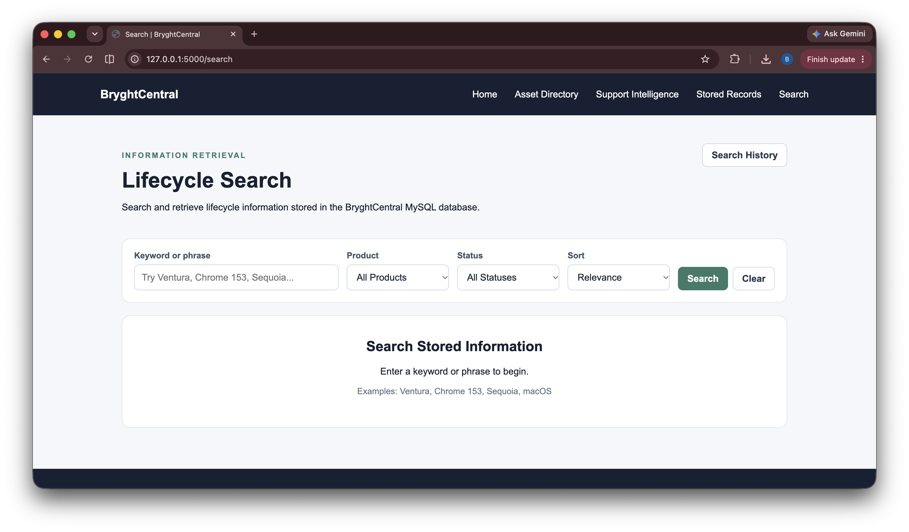
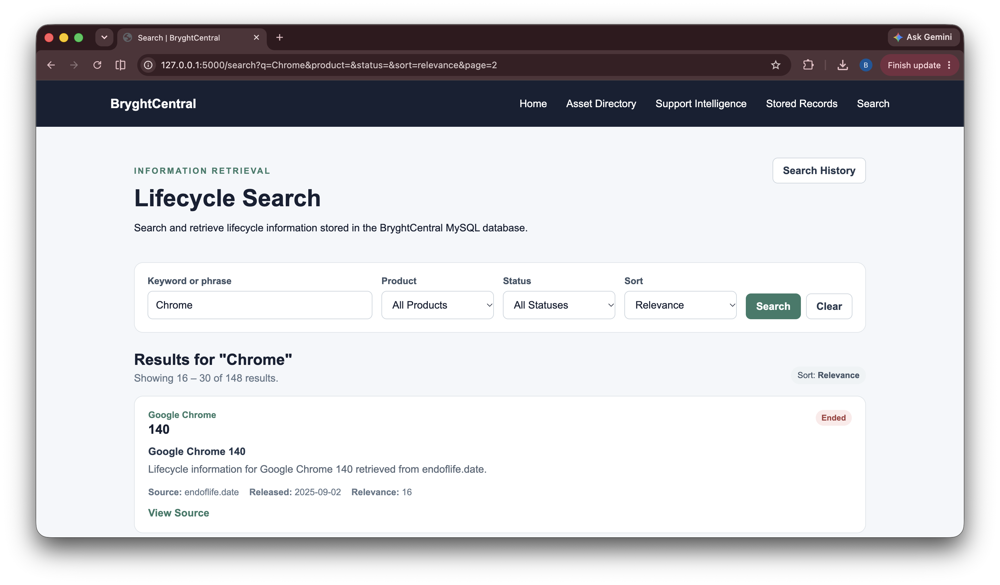
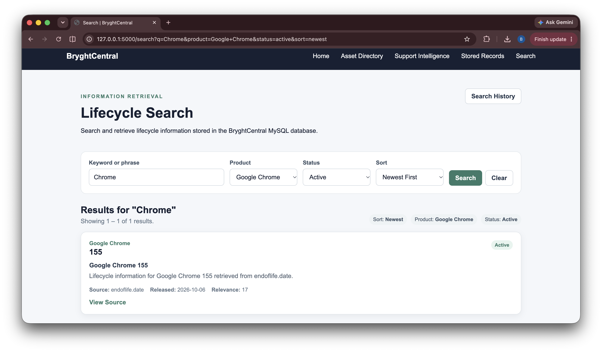
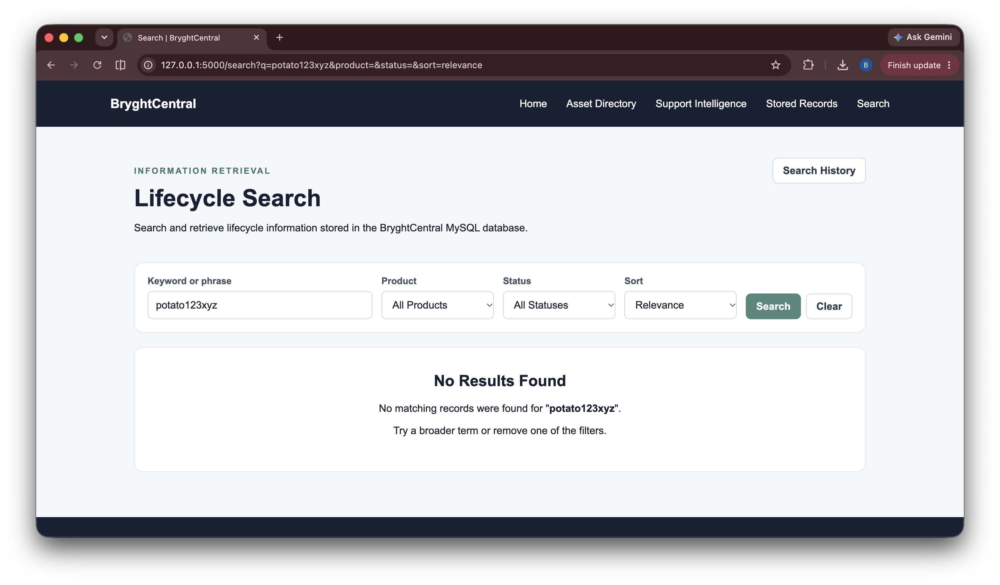
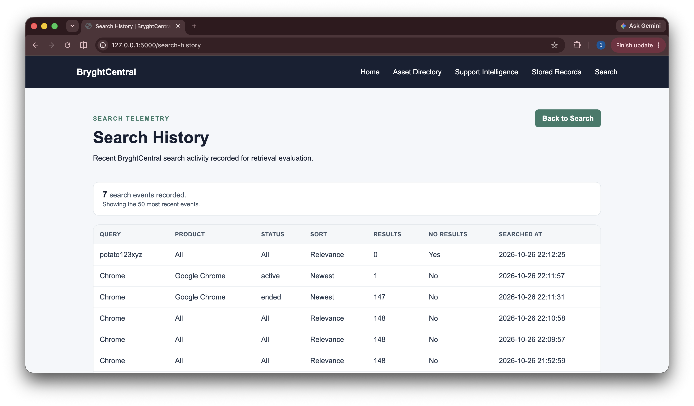

# BryghtCentral

**Student:** Bryan Gutierrez  
**Course:** IT401 — Web Intelligence  
**Assignment:** A4 — Expanding the Web Intelligence Application with Search

---

## Project Overview

BryghtCentral is an IT operations intelligence application built with Flask. The project is designed as a centralized interface for viewing organizational assets, checking software lifecycle information, storing externally acquired information, and retrieving relevant records from a persistent database.

The application has grown across the IT401 assignments:

- **A1:** Established the BryghtCentral application and Asset Directory.
- **A2:** Added external information acquisition using an API and web scraping.
- **A3:** Added MySQL persistence, SQLAlchemy models, database migrations, and CRUD functionality.
- **A4:** Adds information retrieval through keyword search, Boolean filtering, relevance ranking, sorting, pagination, search telemetry, and retrieval evaluation.

BryghtCentral is intended for IT support technicians, administrators, and other technical staff who need to quickly determine software lifecycle status and locate useful support information.

The A4 search system improves the application by allowing users to retrieve relevant lifecycle records instead of manually browsing all stored database entries.

---

# Current Application Features

BryghtCentral currently includes:

- Homepage and application navigation
- Asset Directory
- Asset searching and filtering
- External API integration
- Web scraping
- Support Intelligence interface
- Software lifecycle recommendations
- MySQL database persistence
- SQLAlchemy ORM models
- Flask-Migrate database migrations
- Create, Read, Update, and Delete operations
- Duplicate prevention
- Data validation
- Stored-record browsing
- Keyword search
- Multi-field retrieval
- Product filtering
- Lifecycle-status filtering
- Relevance ranking
- Multiple sorting options
- Pagination
- Search-state preservation
- Search telemetry
- Search-history interface
- Helpful no-results states
- Database and search error handling

---

# Information Sources

BryghtCentral currently acquires external information from two primary sources.

## endoflife.date API

Lifecycle information for:

- Apple macOS
- Google Chrome

is retrieved from the endoflife.date API.

This information includes fields such as:

- Product
- Version
- Codename
- Release date
- Maintenance status
- End-of-life status
- End-of-life date
- Latest version
- Latest release date

The lifecycle information acquired through the API is permanently stored in MySQL.

## Apple Security Releases

BryghtCentral also scrapes Apple's public security-release page to obtain information related to Apple software security updates.

This scraped information is used by the Support Intelligence feature and is currently retrieved when needed rather than permanently stored.

---

# Information Persistence

A3 introduced permanent information storage using MySQL and Flask-SQLAlchemy.

Lifecycle information from endoflife.date is stored in the `lifecycle_records` table.

The current database contains approximately:

- **23 Apple macOS lifecycle records**
- **148 Google Chrome lifecycle records**
- **171 lifecycle records total**

Persisting this information allows BryghtCentral to search and retrieve lifecycle data without calling the external API for every user search.

This creates the following flow:

```text
External API
     ↓
Data Acquisition
     ↓
Validation
     ↓
MySQL Persistence
     ↓
Search and Retrieval
     ↓
User Interface
```

The search functionality introduced in A4 operates on the information already stored in MySQL.

---

# Database Integration

BryghtCentral uses the following persistence stack:

```text
Flask
  ↓
Flask-SQLAlchemy
  ↓
SQLAlchemy ORM
  ↓
PyMySQL
  ↓
MySQL / MariaDB-Compatible CI Keys Database
```

During local development, the application connects to the remote CI Keys database through an SSH tunnel.

```text
Local Flask Application
        ↓
127.0.0.1:3307
        ↓
SSH Tunnel
        ↓
CI Keys Server
        ↓
MySQL :3306
```

Database credentials are stored in a local `.env` file and are not committed to Git.

---

# Database Schema

A4 uses two primary SQLAlchemy models.

---

## LifecycleRecord

**Table:** `lifecycle_records`

**Purpose:**  
Stores lifecycle information acquired from endoflife.date.

| Attribute | Purpose |
|---|---|
| `id` | Internal primary key |
| `title` | Human-readable record title |
| `description` | Description of the lifecycle record |
| `source` | Information source |
| `source_url` | Original source URL |
| `retrieved_date` | Date and time information was retrieved |
| `created_date` | Date and time database record was created |
| `product` | Product name |
| `version` | Product version |
| `codename` | Optional product codename |
| `release_date` | Product release date |
| `is_maintained` | Whether the release is actively maintained |
| `is_eol` | Whether the release has reached end of life |
| `eol_date` | Known end-of-life date |
| `latest_version` | Latest available version |
| `latest_release_date` | Date of latest available release |
| `external_id` | Identifier derived from the external source |

### Duplicate Prevention

Lifecycle records use a unique constraint based on:

```text
source + external_id
```

This prevents synchronization from creating duplicate records.

When lifecycle data is synchronized again, existing records are updated rather than duplicated.

---

## SearchEvent

**Table:** `search_events`

**Purpose:**  
Stores basic telemetry for completed searches.

| Attribute | Purpose |
|---|---|
| `id` | Primary key |
| `query` | Original query entered by the user |
| `normalized_query` | Processed lowercase query |
| `product_filter` | Product filter used |
| `status_filter` | Status filter used |
| `sort_option` | Selected result ordering |
| `result_count` | Number of records matching the search |
| `no_results` | Indicates whether the search returned zero results |
| `searched_at` | Date and time the search occurred |

The current schema can be summarized as:

```text
LifecycleRecord
────────────────────────────
PK  id
    title
    description
    source
    source_url
    retrieved_date
    created_date
    product
    version
    codename
    release_date
    is_maintained
    is_eol
    eol_date
    latest_version
    latest_release_date
    external_id


SearchEvent
────────────────────────────
PK  id
    query
    normalized_query
    product_filter
    status_filter
    sort_option
    result_count
    no_results
    searched_at
```

The two tables currently do not require a direct foreign-key relationship. Search telemetry describes retrieval activity across the lifecycle collection rather than an individual record.

---

# Search and Retrieval Features

A4 transforms BryghtCentral from a database browsing application into a searchable information system.

The primary search interface is available at:

```text
/search
```

Searches use HTTP GET requests.

Example:

```text
/search?q=Ventura&product=&status=&sort=relevance
```

Using GET requests allows searches to:

- Remain visible in the URL
- Be bookmarked
- Be shared
- Preserve search state during navigation
- Preserve filters and sorting during pagination

---

# Searchable Information

The primary searchable model is:

```text
LifecycleRecord
```

The following fields are searched:

- `title`
- `description`
- `product`
- `version`
- `codename`

These fields were selected because they contain information a technician is likely to know when looking for a lifecycle record.

For example, a technician may search for:

```text
Ventura
```

without knowing that Ventura corresponds to macOS 13.

Likewise:

```text
Chrome 153
```

can match both the product and version information.

Fields such as dates and lifecycle Boolean values are not treated as free-text search fields because they work better as sorting criteria or structured filters.

---

# Query Processing

Before database retrieval occurs, the user's query is processed.

BryghtCentral currently performs the following steps:

1. Preserves the original query for display.
2. Removes unnecessary leading and trailing whitespace.
3. Collapses repeated internal whitespace.
4. Converts the normalized query to lowercase.
5. Breaks the query into whitespace-separated tokens.
6. Rejects empty queries.
7. Rejects queries longer than 200 characters.
8. Uses SQLAlchemy expressions rather than manually inserting raw input into SQL.

Example:

```text
Original Query:
   Chrome   153

Normalized Query:
chrome 153

Tokens:
chrome
153
```

This represents a basic form of tokenization and normalization.

The original user query is still displayed in the interface while the normalized form is used for consistent comparison.

---

# Multi-Field Retrieval

Search queries are matched against multiple fields using SQLAlchemy.

Conceptually:

```text
Query
  ↓
title
OR description
OR product
OR version
OR codename
```

For multi-token queries, each query term must appear somewhere within the searchable fields.

For example:

```text
Chrome 153
```

requires both:

```text
Chrome
AND
153
```

to appear within the searchable lifecycle record.

This improves retrieval precision compared with searching only one database field.

---

# Boolean Filtering

BryghtCentral provides two optional structured filters.

## Product Filter

Users may select:

```text
All Products
Apple macOS
Google Chrome
```

The available product values are read from the stored database records.

## Status Filter

Users may select:

```text
All Statuses
Active
Ended
Unknown
```

The filters are combined with the keyword query.

Conceptually:

```text
keyword
AND product
AND lifecycle status
```

Example:

```text
Chrome
AND Google Chrome
AND Ended
```

Filters can be removed or changed directly from the interface.

---

# Sorting Options

BryghtCentral provides four result-ordering options.

## Relevance

Orders results according to the application's custom relevance score.

## Newest First

Orders results using release date in descending order.

## Oldest First

Orders results using release date in ascending order.

## Alphabetical

Orders results by product and version.

---

# Relevance Ranking

BryghtCentral uses a transparent rule-based relevance score.

The ranking strategy gives stronger weight to matches in fields that more directly identify a release.

Conceptual weighting:

```text
Exact title match        +10
Exact product match       +9
Exact codename match      +8
Exact version match       +7

Partial title match       +5
Partial product match     +4
Partial codename match    +4
Partial version match     +4
Description match         +1
```

Individual query tokens may also contribute additional relevance points.

A small boost is also given to currently maintained releases.

This strategy is appropriate for BryghtCentral because lifecycle records have clearly structured identifying fields.

A match in:

```text
product
version
codename
```

is generally more useful than the same word appearing only in a longer description.

For example:

```text
Search: Ventura
```

returns:

```text
Apple macOS
Version 13
Codename Ventura
```

as the highest and only result.

---

# Retrieval Workflow

The complete A4 search workflow is:

```text
User enters search query
          ↓
Flask receives GET request
          ↓
Query is normalized
          ↓
Query is tokenized
          ↓
SQLAlchemy builds retrieval statement
          ↓
Search multiple LifecycleRecord fields
          ↓
Apply product filter
          ↓
Apply lifecycle-status filter
          ↓
Calculate relevance score
          ↓
Apply selected sorting strategy
          ↓
Paginate results
          ↓
Render Jinja results template
          ↓
Record SearchEvent telemetry
```

The retrieval sequence follows:

```text
Retrieve
   ↓
Filter
   ↓
Rank
   ↓
Paginate
   ↓
Display
```

---

# Pagination

Search results are limited to:

```text
15 results per page
```

This prevents the application from rendering the entire result collection at once.

Pagination displays:

- Previous navigation
- Next navigation
- Current page
- Total pages
- Current result range
- Total result count

Example:

```text
Showing 16–30 of 148 results
Page 2 of 10
```

Pagination links preserve:

```text
query
product filter
status filter
sort selection
page
```

Example:

```text
/search?q=Chrome&product=&status=&sort=relevance&page=2
```

This prevents the user's search state from being lost while navigating between pages.

---

# Results Presentation

Each search result displays information intended to help a technician quickly determine whether the record is useful.

Displayed fields include:

- Product
- Version
- Codename when available
- Lifecycle status
- Record title
- Description
- Source
- Release date
- Relevance score
- Link to the original source

BryghtCentral distinguishes among several retrieval states.

## Before Searching

```text
Enter a keyword or phrase to begin.
```

## Results Found

Example:

```text
Results for "Chrome"

Showing 1–15 of 148 results.
```

## No Results

Example:

```text
No Results Found

No matching records were found for "potato123xyz".

Try a broader term or remove one of the filters.
```

## Search Error

If database retrieval fails, the application displays a user-friendly message instead of exposing a full traceback.

---

# Search Telemetry

A4 adds search telemetry using the `SearchEvent` model.

Each completed first-page search records:

- Original query
- Normalized query
- Product filter
- Status filter
- Sorting option
- Total result count
- Whether zero results were returned
- Search date and time

Pagination requests do not create additional telemetry events for the same search.

This prevents a user clicking:

```text
Page 1
Page 2
Page 3
```

from being counted as three separate searches.

The telemetry interface is available at:

```text
/search-history
```

The Search History page displays up to the 50 most recent events.

Telemetry could later help BryghtCentral identify:

- Common search terms
- Frequently used filters
- Searches that return no results
- Searches that may need synonyms
- Popular product families
- Search behavior that could improve recommendations
- Opportunities for better relevance ranking

BryghtCentral currently does not store sensitive personal information in search telemetry.

---

# Search Evaluation

Five test queries were used to evaluate BryghtCentral's retrieval quality.

| Query | Expected Relevant Records | Results Returned | Ranking Observation |
|---|---|---:|---|
| `Ventura` | Apple macOS 13 Ventura | 1 | Expected record ranked first |
| `Chrome 153` | Google Chrome 153 | 1 | Exact version returned as the only result |
| `Sequoia` | Apple macOS 15 Sequoia | 1 | Expected record ranked first |
| `macOS` | Stored Apple macOS lifecycle records | 23 | Current and recent macOS releases appeared near the top |
| `Chrome` | Stored Google Chrome lifecycle records | 148 | Chrome 155 appeared first followed by recent versions |

## Detailed Results

### Query 1 — Ventura

Expected:

```text
Apple macOS 13
Codename: Ventura
```

Actual:

```text
1 result
Relevance score: 14
Apple macOS 13 — Ventura
```

No obvious false positives were returned.

The expected relevant record was not missed.

**Precision observation:** Excellent. The only returned result was useful.

**Recall observation:** Strong. The expected record was successfully retrieved.

---

### Query 2 — Chrome 153

Expected:

```text
Google Chrome 153
```

Actual:

```text
1 result
Relevance score: 18
Google Chrome 153
```

No obvious false positives were returned.

The expected record was not missed.

**Precision observation:** Excellent.

**Recall observation:** Strong.

---

### Query 3 — Sequoia

Expected:

```text
Apple macOS 15
Codename: Sequoia
```

Actual:

```text
1 result
Relevance score: 15
Apple macOS 15 — Sequoia
```

No obvious false positives were returned.

The expected record was not missed.

**Precision observation:** Excellent.

**Recall observation:** Strong.

---

### Query 4 — macOS

Expected:

```text
Apple macOS lifecycle records
```

Actual:

```text
23 results
```

Top results included:

```text
macOS 27 — Golden Gate
macOS 26 — Tahoe
macOS 15 — Sequoia
macOS 14 — Sonoma
macOS 13 — Ventura
```

The returned records belonged to the expected macOS product family.

**Precision observation:** High because the results were relevant to the requested product.

**Recall observation:** Strong within the current lifecycle dataset because the stored macOS collection was retrieved.

---

### Query 5 — Chrome

Expected:

```text
Google Chrome lifecycle records
```

Actual:

```text
148 results
```

Top results included:

```text
Chrome 155
Chrome 154
Chrome 153
Chrome 152
Chrome 151
```

The most current Chrome release appeared first.

**Precision observation:** High because returned records belonged to Google Chrome.

**Recall observation:** Strong within the current stored Chrome collection.

---

# Evaluation Summary

The five test queries demonstrated strong retrieval quality for the current dataset.

Specific queries such as:

```text
Ventura
Chrome 153
Sequoia
```

returned exactly one highly relevant record.

Broader product queries such as:

```text
macOS
Chrome
```

returned their expected product collections without obvious false positives.

The rule-based relevance strategy successfully placed current or recent records near the top when several records had similar textual relevance.

Formal mathematical precision and recall calculations were not required for this evaluation, so they are discussed qualitatively.

One future improvement would be adding synonym-aware or semantic retrieval. The current system depends primarily on stored text matching and does not understand that two different words may represent related concepts.

---

# Reliability and Error Handling

BryghtCentral handles common search failures gracefully.

## Empty Query

An empty query does not execute a normal search.

The user receives:

```text
Enter a keyword or phrase to begin searching.
```

## Very Long Query

Queries longer than 200 characters are rejected.

## Invalid Product Filter

Product values are validated against products stored in the database.

Invalid product filters are rejected.

## Invalid Status Filter

Only supported lifecycle states are accepted.

## Invalid Sorting Option

Unsupported sorting values are rejected.

## Invalid Page Number

Invalid or negative page values are normalized to a valid page.

If a requested page is beyond the available result set, BryghtCentral displays the final valid page.

## No Results

A zero-result search produces a helpful user-facing message with suggestions to broaden the query or remove filters.

## Database Failure

Database exceptions are caught and the SQLAlchemy session is rolled back where appropriate.

Users receive a helpful search-unavailable message rather than a raw database traceback.

## Telemetry Failure

Search telemetry is intentionally separated from retrieval.

If saving a `SearchEvent` fails:

- The database transaction is rolled back.
- Search results may still be displayed.
- The user receives a telemetry warning instead of losing the search results.

---

# CRUD Functionality

A3 CRUD functionality remains available in A4.

Users can:

## Create

Manually create a lifecycle record.

Required values are validated before insertion.

## Read

View persisted lifecycle records through the Stored Records interface.

## Update

Modify an existing lifecycle record.

## Delete

Remove a stored lifecycle record.

Duplicate protection continues to use:

```text
source + external_id
```

---

# Lifecycle Synchronization

BryghtCentral can synchronize lifecycle information from endoflife.date.

The synchronization system:

1. Retrieves external lifecycle information.
2. Converts external values into application fields.
3. Checks for an existing record using `source + external_id`.
4. Creates missing records.
5. Updates existing records.
6. Commits the transaction.

A repeated synchronization demonstrated duplicate-safe behavior:

```text
Created: 0
Updated: 171
```

This confirms that synchronization updates existing records rather than creating duplicate lifecycle entries.

---

# Application Architecture

BryghtCentral separates major responsibilities across routes, models, services, templates, and static files.

```text
Browser
   ↓
Flask Route
   ↓
Search Service
   ↓
SQLAlchemy ORM
   ↓
MySQL
   ↓
Search Results
   ↓
Jinja Template
   ↓
Browser
```

Search telemetry follows a second path:

```text
Completed Search
      ↓
SearchEvent Model
      ↓
SQLAlchemy
      ↓
MySQL
      ↓
Search History
```

Separating retrieval logic from Flask routing keeps the application easier to maintain and prepares the project for later intelligent-system features.

---

# Project Structure

```text
bryan-it401-project/
│
├── app.py
├── extensions.py
├── requirements.txt
├── README.md
├── .env
├── .env.example
├── .gitignore
├── sync_lifecycle.py
│
├── data/
│   └── assets.json
│
├── migrations/
│   ├── README
│   ├── alembic.ini
│   ├── env.py
│   ├── script.py.mako
│   └── versions/
│       ├── 0772cbdf46e6_create_lifecycle_records_table.py
│       └── 4dece5aa8ef5_create_search_events_table.py
│
├── models/
│   ├── __init__.py
│   ├── lifecycle.py
│   └── search_event.py
│
├── routes/
│   ├── main.py
│   ├── lifecycle_records.py
│   └── search.py
│
├── services/
│   ├── lifecycle_api.py
│   ├── apple_scraper.py
│   ├── lifecycle_persistence.py
│   └── search_service.py
│
├── templates/
│   ├── base.html
│   ├── index.html
│   ├── assets.html
│   ├── support_intelligence.html
│   ├── stored_releases.html
│   ├── lifecycle_form.html
│   ├── search.html
│   └── search_history.html
│
└── static/
    ├── style.css
    │
    └── screenshots/
        ├── homepage.png
        ├── asset-directory.png
        ├── filtered-assets.png
        │
        ├── a2-homepage.png
        ├── a2-api-results.png
        ├── a2-scraped-results.png
        ├── a2-combined-interface.png
        ├── a2-error-handling.png
        │
        ├── a3-homepage.png
        ├── a3-stored-records.png
        ├── a3-crud-interface.png
        ├── a3-sync-success.png
        ├── a3-validation.png
        │
        ├── a4-search-form.png
        ├── a4-ranked-results.png
        ├── a4-pagination.png
        ├── a4-filtered-results.png
        ├── a4-active-filter.png
        ├── a4-no-results.png
        └── a4-search-history.png
```

---

# Important File Responsibilities

## `app.py`

Creates and configures the Flask application.

Responsibilities include:

- Loading environment variables
- Configuring the database connection
- Initializing SQLAlchemy
- Initializing Flask-Migrate
- Registering application routes

## `extensions.py`

Creates reusable SQLAlchemy and Flask-Migrate extension instances.

## `models/lifecycle.py`

Defines the persisted lifecycle information model.

## `models/search_event.py`

Defines the A4 search telemetry model.

## `routes/main.py`

Handles the original BryghtCentral pages and support-intelligence routes.

## `routes/lifecycle_records.py`

Handles stored lifecycle record browsing and CRUD functionality.

## `routes/search.py`

Handles:

- Search HTTP requests
- Search form state
- Search-result rendering
- Telemetry recording
- Search-history display

## `services/lifecycle_api.py`

Retrieves lifecycle information from endoflife.date.

## `services/apple_scraper.py`

Retrieves Apple security-release information from Apple's website.

## `services/lifecycle_persistence.py`

Synchronizes external lifecycle information into MySQL.

## `services/search_service.py`

Contains A4 information-retrieval logic, including:

- Query normalization
- Tokenization
- Multi-field searching
- Boolean filtering
- Relevance scoring
- Sorting
- Pagination
- Search telemetry storage

## `templates/search.html`

Displays:

- Search controls
- Keyword field
- Filters
- Sorting controls
- Search results
- Relevance scores
- Pagination
- Empty-query state
- No-results state
- Error messages

## `templates/search_history.html`

Displays recorded search telemetry.

---

# Installation Instructions

## 1. Clone the Repository

```bash
git clone <repository-url>
cd bryan-it401-project
```

Switch to the A4 branch if necessary:

```bash
git switch bryan-it401-a4
```

---

## 2. Create a Virtual Environment

```bash
python3 -m venv .venv
```

Activate it:

### macOS / Linux

```bash
source .venv/bin/activate
```

### Windows

```text
.venv\Scripts\activate
```

---

## 3. Install Dependencies

```bash
pip install -r requirements.txt
```

Major dependencies include:

- Flask
- Flask-SQLAlchemy
- Flask-Migrate
- SQLAlchemy
- PyMySQL
- python-dotenv
- requests
- BeautifulSoup

---

# Environment Variables

Create:

```text
.env
```

from:

```text
.env.example
```

Required variables:

```text
DB_USERNAME=
DB_PASSWORD=
DB_HOST=127.0.0.1
DB_PORT=3307
DB_NAME=
SECRET_KEY=
```

Actual credentials must never be committed to Git.

The project currently does not require an API key for the endoflife.date or Apple security-release sources.

---

# Generating a Secret Key

A development secret key can be generated with:

```bash
python -c "import secrets; print(secrets.token_hex(32))"
```

Store the result only in:

```text
.env
```

---

# CI Keys Database Connection

When running the application locally, create the SSH tunnel before starting Flask.

Example:

```bash
ssh -N -T \
-o IdentitiesOnly=yes \
-o ExitOnForwardFailure=yes \
-L 127.0.0.1:3307:127.0.0.1:3306 \
-i ~/.ssh/cikeys \
-p 22 \
YOUR_CPANEL_USERNAME@csuci.dooo.host.reclaimhosting.com
```

Keep that Terminal session open while using the application.

The Flask application then connects through:

```text
DB_HOST=127.0.0.1
DB_PORT=3307
```

---

# Database Migrations

Apply all existing migrations with:

```bash
flask db upgrade
```

When a model changes, create a migration using:

```bash
flask db migrate -m "Describe migration"
```

Then apply it:

```bash
flask db upgrade
```

A4 adds the `search_events` table through a migration.

---

# Running the Application

Start BryghtCentral with:

```bash
python app.py
```

Then open:

```text
http://127.0.0.1:5000
```

Primary routes include:

```text
/
 /assets
 /support-intelligence
 /stored-releases
 /stored-releases/create
 /search
 /search-history
```

---

# Screenshots

## A4 Search Interface



The dedicated information-retrieval interface provides a keyword field, product filter, lifecycle-status filter, sorting control, and search button.

---

## A4 Ranked Search Results


A broad search for Chrome demonstrates keyword retrieval and relevance ordering.

---

## A4 Pagination



The Chrome search returns 148 records. Results are limited to 15 per page while the query, filters, and sorting state remain preserved.

---

## A4 Filtered and Sorted Results


The interface demonstrates combined:

```text
Keyword: Chrome
Product: Google Chrome
Status: Ended
Sort: Newest First
```

---

## A4 Active Lifecycle Filter



Applying the Active lifecycle filter reduces the Chrome result set to the currently maintained release.

---

## A4 No-Results State



The application provides a helpful message when no matching records are found.

---

## A4 Search Telemetry



The Search History interface shows recorded queries, filters, sort selections, result counts, no-result status, and timestamps.

---

# Design Decisions

## Why These Fields Are Searchable

The following fields were selected:

```text
title
description
product
version
codename
```

because they represent the information users are most likely to know when attempting to identify a software release.

For example, a technician might know:

```text
Ventura
```

without knowing:

```text
macOS 13
```

Searching the codename makes that information discoverable.

---

## Why Product and Status Are Filters

Product and lifecycle state are structured attributes with a limited set of possible values.

They are therefore more appropriate as Boolean-style filters than as free-text search fields.

---

## Why Relevance Uses a Custom Score

BryghtCentral currently contains a relatively small and highly structured lifecycle dataset.

A rule-based relevance model provides several advantages:

- Easy to explain
- Easy to debug
- Predictable behavior
- No additional search infrastructure
- Strong matches in important fields can be weighted more heavily

This approach is appropriate for the current scale of the project.

---

## Why Pagination Uses 15 Results

A page size of:

```text
15
```

was selected as a balance between:

- Displaying enough information to browse efficiently
- Keeping pages manageable
- Avoiding rendering the full result collection
- Providing meaningful pagination for large searches such as Chrome

---

## Why Search Telemetry Is Stored

Search telemetry prepares BryghtCentral for later intelligent-system functionality.

Future versions could use search activity to identify:

- Common user needs
- Frequently searched products
- Poor-performing queries
- Missing terminology
- Failed searches
- Useful ranking improvements
- Recommendation opportunities

---

# Ethical and Privacy Considerations

Search telemetry can potentially reveal user interests or behavior.

BryghtCentral currently avoids collecting sensitive personal information.

The telemetry model stores retrieval activity rather than identity information.

If authentication or personalized search is added later, additional privacy controls would be necessary.

Potential improvements could include:

- Retention limits
- User consent
- Anonymization
- Administrative access controls
- Telemetry deletion policies

---

# Known Limitations

The current retrieval system intentionally remains understandable and relatively simple.

Known limitations include:

- Search is primarily keyword-based.
- Synonyms are not understood automatically.
- Singular and plural forms may produce different results.
- Stemming and lemmatization are not implemented.
- Typographical errors are not automatically corrected.
- Ranking is rule-based.
- MySQL full-text indexing is not currently used.
- Search is not personalized.
- Search results do not currently learn from previous user selections.
- Result clicks and selected-result rank are not yet recorded.
- Search suggestions are not implemented.
- Autocomplete is not implemented.
- Semantic similarity is not implemented.
- The current stored lifecycle collection is limited mainly to macOS and Google Chrome.
- Search relevance is optimized for the current structured lifecycle dataset rather than general unstructured documents.

---

# Future Work

Future modules can build intelligent behavior on top of the A4 retrieval foundation.

Potential improvements include:

## Semantic Search

Use embeddings or another semantic representation so conceptually related queries can match even when they do not use the same words.

## Search Suggestions

Recommend alternate queries when a search produces few or no results.

## Autocomplete

Use existing stored products, versions, and search-history terms to suggest queries while the user types.

## Typo Tolerance

Handle small misspellings and spelling variations.

## Full-Text Indexing

Use MySQL full-text indexes if the database grows large enough that wildcard matching becomes inefficient.

## Personalized Ranking

Use user role, device environment, or previous interactions to prioritize relevant records.

## Search Interaction Telemetry

Record:

- Result selected
- Selected result rank
- Time to selection
- Query reformulation
- Abandoned searches

## Recommendations

Use stored information, search context, lifecycle status, and telemetry to recommend:

- Software upgrades
- Devices requiring attention
- Unsupported products
- Replacement priorities
- Appropriate software versions

## Retrieval-Augmented Intelligence

Retrieved lifecycle information could eventually provide grounded context to an intelligent component that generates explanations or IT recommendations.

---

# Technologies Used

- Python
- Flask
- Flask-SQLAlchemy
- SQLAlchemy
- Flask-Migrate
- Alembic
- PyMySQL
- MySQL / MariaDB
- python-dotenv
- Requests
- BeautifulSoup
- HTML
- CSS
- Jinja
- Git
- GitHub
- CI Keys
- SSH tunneling

---

# Assignment Progress

```text
A1 — Application Foundation                 Complete
A2 — Information Acquisition                Complete
A3 — Information Persistence                Complete
A4 — Search and Information Retrieval       Complete
```

BryghtCentral now supports the full information flow developed through the first four application assignments:

```text
Acquire
   ↓
Persist
   ↓
Retrieve
   ↓
Rank
   ↓
Present
```

This retrieval foundation prepares the application for later IT401 modules involving intelligent behavior, recommendations, and decision support.